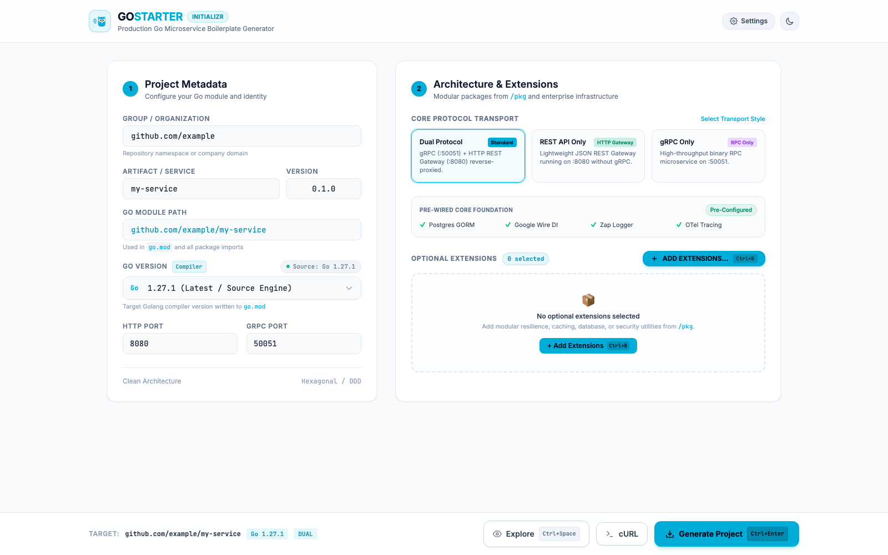
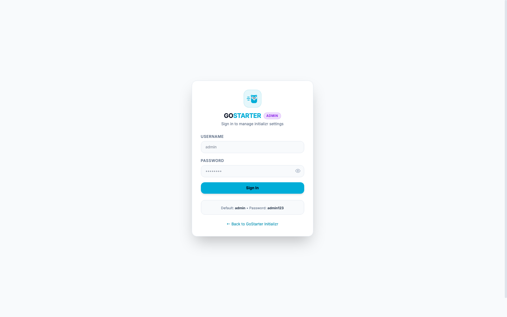

## Menjalankan aplikasi

Siapkan Go, Node.js 22+, npm, `.env`, dan PostgreSQL, lalu jalankan:

```sh
make start
```

Satu binary menjalankan web/API, memproses Sync Admin, dan menjalankan validasi generation. Ctrl+C menghentikan semuanya. Untuk PostgreSQL lokal melalui Docker, jalankan `make db-up` terlebih dahulu. Gunakan `make dev` untuk menjalankan langsung dari source.

Buka aplikasi pada port `APP_PORT`, login Admin, lalu klik **Sync** untuk mengambil upstream pertama kali. Kedua proses memakai konfigurasi database dan direktori snapshot yang sama. Worker tidak melakukan sync otomatis.

`cmd/server` adalah satu-satunya entry point aplikasi. `tools/` berisi alat bantu development yang opsional. Deployment menggunakan satu container melalui [Compose](deployments/compose.yml).

# GoStarter — The Production Go Initializr

<p align="center">
  
</p>

A modern web-based project generator inspired by [start.spring.io](https://start.spring.io), specifically crafted for the Golang ecosystem.

GoStarter allows developers to dynamically configure, preview in-browser, and generate production-ready microservices implementing **Feature-Based Modular Clean Architecture** (Hexagonal/DDD).

---

## 📸 Showcase

### 1. Initializr Generator Dashboard


### 2. Admin Console & Upstream Sync


---

## ✨ Features

- **Bespoke Go Visual Identity**: Custom **Speed Gopher** emblem combining the beloved Go Gopher mascot with the 3 aerodynamic Go speed motion trails (`≡`) in official Go Blue (`#00ADD8`), complete with SVG tab favicons.
- **Tailwind CSS v3 UI**: Clean, modern interface designed with Tailwind CSS v3, featuring a persistent light/dark theme with zero transition flash on reload.
- **Profile Go Versions**: Supported compiler versions and protocols come from server metadata for the active architecture profile.
- **Dynamic Extensions**: Features and Packages come from the upstream manifest, including titles and descriptions. Optional selections start empty; core remains mandatory.
- **Dependency Locks**: Resolver responses show automatic dependencies and their reasons. Explicit choices survive removal of a parent when still selected.
- **Asynchronous Plans**: Editing invalidates the previous plan; preview and download require the latest validated, unexpired plan.
- **Base64 cURL Command (`>_ cURL`)**: Instant modal providing a clean, single-click copy-paste cURL command with compact base64-encoded configuration parameters (`/starter.zip?config=...`), keeping terminal commands neat without exposing complex JSON payloads.
- **Semver Project Versioning**: Project version input (`0.1.0`) automatically injected into generated configuration files, `.env`, and `.env.example` (`APP_VERSION=...`).
- **Protocol Flexibility (Core Foundation)**:
  - **Dual Protocol (gRPC + HTTP REST Gateway)**: High-throughput gRPC on `:50051` and HTTP REST on `:8080` reverse-proxied via grpc-gateway.
  - **gRPC Only**: Binary microservice running over gRPC on `:50051`.
- **Pre-Wired Core Foundation**:
  - `PostgreSQL (GORM + Auto Migrate)`
  - `Google Wire (Compile-Time DI)`
  - `Zap Structured JSON Logger`
  - `OpenTelemetry (APM Tracing & Prometheus /metrics)`
- **Spring Initializr "Add Extensions" Modal (`Ctrl + B`)**:
  - Searchable popup dialog with category filters and instant toggle selection.
  - Active extensions displayed as cards with one-click `✕` remove buttons on the main screen.
- **Manifest Catalog**: Optional feature/pkg entries are supplied by upstream. Core, infrastructure and integration templates remain owned by GoStarter. See the [upstream contract](docs/contracts/upstream-manifest-v1.md).
- **Interactive Project Explorer (`Ctrl + Space`)**: Inspect the generated directory hierarchy and preview code files directly in the browser before downloading.
- **Admin Console & Settings (`/admin`)**:
  - **Bcrypt-Hashed Authentication**: Secure login protected with `golang.org/x/crypto/bcrypt` (username & password).
  - **Stateful DB Sessions**: Active session tokens stored and verified in PostgreSQL (`admin_sessions`).
  - **Configurable Global Defaults**: Initializr defaults saved directly to PostgreSQL (`admin_settings`).
  - **System Status & Upstream Sync**: Source/ref/full SHA, active and candidate snapshots, validation summaries, scheduled sync, and compatible snapshot rollback.
- **Immutable Source Snapshots**: The embedded worker downloads and validates upstream candidates before activation. Source archives live on the snapshot volume; generated ZIPs are streamed without persistence.


---

## 🛠️ Makefile Commands

GoStarter includes a comprehensive `Makefile` to streamline development, building, testing, and database management:

| Command | Description |
| :--- | :--- |
| `make build` | Compile the optimized standalone binary into `./bin/gostarter` |
| `make run` | Build and run the server binary `./bin/gostarter` |
| `make dev` | Run server directly with compilation (`go run ./cmd/server`) |
| `make test` | Run all automated unit tests across internal packages |
| `make test-ui` | Run JavaScript plan state tests with Node.js |
| `make test-race` | Run unit tests with the Go race condition detector enabled |
| `make test-cover` | Run unit tests and output code coverage percentage |
| `make fmt` | Format all Go source files according to `gofmt` standards |
| `make vet` | Run `go vet` static code analysis |
| `make tidy` | Sync and tidy `go.mod` and `go.sum` dependencies |
| `make clean` | Remove compiled binaries (`bin/`) and test coverage files |
| `make db-up` | Launch local PostgreSQL 16 container in Docker (`gostarter-postgres`) |
| `make db-down` | Stop and remove the local PostgreSQL Docker container |
| `make help` | Display available targets and descriptions |

---

## 🚀 Quick Start

### 1. Build and Run

```bash
# 1. Clone repository
git clone https://github.com/kal72/gostarter.git
cd gostarter

# 2. Copy sample environment file
cp .env.example .env

# 3. (Optional) Start local PostgreSQL with Docker
make db-up

# 4. Build and start the server
make run
```

Open your browser at:
- **Initializr Generator UI**: `http://localhost:8089` (or configured `APP_PORT`)
- **Admin Console**: `http://localhost:8089/admin`
  - **Username**: `admin`
  - **Password**: `admin123` *(bcrypt-hashed in PostgreSQL)*

---

### 2. Environment Variables & `.env` (Viper)

GoStarter uses [Viper](https://github.com/spf13/viper) to manage configuration. It automatically loads values from `.env` in the current working directory, falling back to OS environment variables and built-in defaults:

| Environment Variable | Default | Description |
| :--- | :--- | :--- |
| `APP_NAME` | `gostarter` | Application identifier |
| `APP_ENV` | `development` | Environment mode (`development`, `production`) |
| `APP_PORT` / `PORT` | `8080` | HTTP web server and API port |
| `APP_READ_TIMEOUT` | `30s` | HTTP server read timeout |
| `APP_WRITE_TIMEOUT` | `60s` | HTTP server write timeout |
| `APP_IDLE_TIMEOUT` | `120s` | HTTP server idle timeout |
| `DB_HOST` | `127.0.0.1` | PostgreSQL database host |
| `DB_PORT` | `5432` | PostgreSQL database port |
| `DB_USER` / `DB_USERNAME` | `postgres` | PostgreSQL username |
| `DB_PASSWORD` / `DB_PASS` | `postgres` | PostgreSQL password |
| `DB_NAME` / `DB_DATABASE` | `gostarter` | PostgreSQL database name |
| `DB_SSLMODE` | `disable` | SSL connection mode (`disable`, `require`, `verify-full`) |
| `DATABASE_URL` / `DB_DSN` | *(empty)* | Optional direct connection URI override |
| `DB_MAX_OPEN_CONNS` | `25` | Maximum active database connections in pool |
| `DB_MAX_IDLE_CONNS` | `10` | Maximum idle database connections in pool |
| `DB_CONN_MAX_LIFETIME` | `15m` | Maximum connection lifetime |
| `UPSTREAM_OWNER` | `kal72` | Reference architecture GitHub repo owner |
| `UPSTREAM_REPO` | `go-feature-based-boilerplate` | Reference architecture GitHub repo name |
| `UPSTREAM_BRANCH` | `main` | Reference architecture Git branch |

### 3. CLI Flag Overrides

CLI flags can be used to override environment settings on startup:

| Flag | Default | Description |
| :--- | :--- | :--- |
| `-env` | *(empty)* | Path to custom `.env` file (e.g. `-env=.env.prod`) |
| `-port` | *(from config)* | HTTP server port override |
| `-db` | *(from config)* | PostgreSQL DSN override |

---

## ⌨️ Keyboard Shortcuts

| Shortcut | Action |
| :--- | :--- |
| <kbd>Ctrl</kbd> + <kbd>B</kbd> | Open "Add Dependencies & Extensions" modal popup |
| <kbd>Ctrl</kbd> + <kbd>Space</kbd> | Open interactive in-browser Project Explorer |
| <kbd>Ctrl</kbd> + <kbd>Enter</kbd> | Generate and download project `.zip` archive |
| <kbd>Esc</kbd> | Close active modal dialog |

---

## 💻 Terminal / cURL Usage

Generation requires PostgreSQL, a compatible active snapshot, and the provisioned build runtime. Run `make start`; the server includes validation and manual Admin sync processing. See [single-process runtime](docs/unified-server.md).

JSON, query parameters, and Base64 all use the same plan pipeline. `/starter.zip` waits at most 10 seconds (`wait=0..10`). An unfinished plan returns **202 JSON**, `Location`, and `Retry-After`; resume with its `plan_id`. Never save a response as ZIP before checking status and content type.

```bash
# Direct query; optional non-default extensions come from /api/v1/info.
endpoint='http://localhost:8089/starter.zip?module=github.com/myorg/order-service&protocol=dual&extensions=auth,idempotency&wait=10'
response=$(mktemp)
status=$(curl -sS -w '%{http_code} %{content_type}' "$endpoint" -o "$response")
if [ "$status" = '200 application/zip' ]; then
  mv "$response" order-service.zip
  unzip order-service.zip
else
  cat "$response" # includes plan_id/status_url when pending, or structured error
  rm -f "$response"
  exit 1
fi
```

For Base64, replace the query with `?config=<URL-safe Base64 JSON>&wait=10`. Example JSON: `{"module":"github.com/myorg/order-service","protocol":"dual","extensions":["auth","idempotency"]}`. Standard/padded/unpadded Base64 and raw JSON are also accepted through the existing config aliases. Do not mix encoded config with other project fields.

Poll `GET /api/v1/plans/{plan_id}` until HTTP 200 with `status: ready`, then call `POST /api/v1/generate` or `/api/v1/explore` with `{"plan_id":"..."}`, or `GET /starter.zip?plan_id=...`. Failed plans return 422, expired plans 410, incompatible validation/template identities 409. A new configuration must be resolved again. See the [stage 6 API contract](docs/stage-6-api.md).

---

## 📡 REST API Endpoints

### Public Endpoints
- `GET /api/v1/info` — Returns server metadata, supported Go versions, and capability manifest.
- `POST /api/v1/resolve` — Resolves selections, persists a pinned plan, and queues validation.
- `GET /api/v1/plans/{id}` — Returns plan status, expiry, dependencies, and bounded diagnostics.
- `POST /api/v1/generate` — Streams a ready plan after regenerating and verifying its validated output.
- `POST /api/v1/explore` — Returns file tree hierarchy and customized contents for in-browser inspection.
- `GET /starter.zip` — Query-parameter and base64-config endpoint for browser and `curl` downloads.

### Admin Endpoints (Protected via Bearer Session Token)
- `POST /api/v1/admin/login` — Authenticate admin using username & bcrypt password. (Default: `admin` / `admin123`).
- `POST /api/v1/admin/logout` — Revoke active session token.
- `GET /api/v1/admin/me` — Verify current session and return authenticated user profile.
- `POST /api/v1/admin/change-password` — Update admin user password with bcrypt hashing.
- `GET /api/v1/admin/stats` — Database health, source/ref/full SHA, validation summaries and active/candidate snapshots.
- `GET /api/v1/admin/settings` — Get default global initializr settings.
- `POST /api/v1/admin/settings` — Update default settings stored in PostgreSQL.
- `POST /api/v1/admin/rollback` — Activate a compatible archived snapshot using revision/epoch fencing.
- `POST /api/v1/admin/sync` — Request manual synchronization by the embedded worker (202).

---

## 🧪 Testing

Run all unit tests across generator, database, handler, and snapshot packages:

```bash
# Run unit tests
make test

# Run tests with race detection
make test-race

# Run tests with coverage output
make test-cover
```

## Upstream contract validation

Validate an explicit local upstream tree using the v1 manifest and application architecture profile:

```sh
go run ./tools/validate-upstream -source /path/to/go-feature-based-boilerplate
```

This checks the static contract without executing upstream scripts or changing files. Add `-details` to inspect file ownership and module requirements. Dependency selection is available through the local plan CLI; production API integration and snapshot activation are implemented in stages 5–6. See [contract v1](docs/contracts/upstream-manifest-v1.md) and [stage 1 results](docs/stage-1-contract-profile.md).

Inspect a static dependency plan from local analysis source:

```sh
go run ./tools/plan-project -source /path/to/go-feature-based-boilerplate -fixture -extensions auth
```

The plan separates explicit choices from locked dependencies and includes a deterministic fingerprint. It does not generate or validate a build. See [stage 2 results](docs/stage-2-resolver-plan.md).


### Generator development (stage 3)

```bash
rtk proxy go run ./tools/render-project -fixture -source /path/to/go-feature-based-boilerplate -out /private/tmp/gostarter-core-review -module example.com/core-service
```

This explicitly materializes and builds a local project (dual by default) using embedded application templates, pinned protobuf/Wire tools, and cached dependencies. The output directory must not exist. Add `-extensions auth` or comma-separated manifest IDs to compose features/pkg and their dependency closure. Use `-protocol grpc` for gRPC-only, or `-protocol dual` for the HTTP gateway. The CLI audits output and returns content/validation digests; the production API uses the same materialization pipeline through persistent plans. See [stage 3A prerequisites](docs/stage-3a-core-templates.md), [stage 3B results](docs/stage-3b-feature-pkg.md), and [stage 3C materialization](docs/stage-3c-materialization.md).


### Persistent metadata and source snapshots (stage 4)

PostgreSQL now includes additive snapshot, source state, plan and validation job repositories. Immutable upstream archives live under `SNAPSHOT_DIR` on a persistent volume; generated project ZIPs and full validation logs are not stored. The development capture command resolves a full commit SHA and stores a downloaded candidate without activation:

```sh
rtk proxy go run ./tools/capture-snapshot -owner kal72 -repo go-feature-based-boilerplate -ref dev -key primary
```

Pool options and admin session lifetime are connected to runtime configuration. Plan expiry, snapshot retention, queue and diagnostic limits are configurable in `.env.example`. Worker validation/activation and production API integration are implemented in stages 5–6. See [stage 4 results and operational limits](docs/stage-4-storage.md).


### Validation and activation

The server embeds the durable PostgreSQL-backed validation worker and manual Admin sync processing. Candidate and user plan validation, leases, retry limits, source revisions, and candidate epochs remain active. Upstream sync starts only after an Admin request. Rollback is available through Admin. There is no separate worker binary or process.

### Dynamic UI and admin (stage 7)

Run `make test-ui` for standalone plan state unit tests. Test inputs are created inline; no upstream checkout or `testdata` directory is required. See [the development roadmap](docs/development-roadmap.md).

### Release integration and operations (stage 8)

CI runs Go unit tests with the race detector, static analysis, compilation, and UI unit tests. PostgreSQL, upstream integration, browser mocks, and generated-project integration suites have been removed. Runtime candidate/plan validation remains enabled. Docker provisions its offline generation dependencies from pinned manifests in `deployments/build-runtime`, independently of tests.

`GET /healthz` checks liveness; `GET /readyz` requires a compatible validated active source archive. The application needs the build runtime. Use `make migrate` or `gostarter -migrate-only` to apply embedded golang-migrate v4 migrations separately; see [database migrations](docs/database-migrations.md). See the [operations and staging checklist](docs/stage-8-operations.md), [stage 8 results](docs/stage-8-release.md), and [Compose example](deployments/compose.yml). Local verification does not imply staging approval or deployment.

### Legacy implementation cleanup

The old string-replacement generator, mutable template cache/auto-sync and unused in-process compatibility adapter have been removed. Preview/ZIP helpers now accept only the service name and materialized files. The public API still accepts supported legacy boolean inputs through its existing request parser and validates them against canonical resolution. See [cleanup audit](docs/legacy-cleanup.md).

### Manual upstream synchronization

Upstream updates run only after an authenticated administrator clicks **Sync**. The API returns 202; the worker consumes that persisted request, downloads the selected source and validates the candidate. Saving defaults/source or starting the application does not schedule sync. Failed sync needs another click; an interrupted in-flight request can resume after its lease expires. Automatic intervals have been removed. See [manual sync behavior and migration](docs/manual-admin-sync.md).

### Application structure

See [application architecture](docs/application-architecture.md) for startup ownership, shared dependencies, lifecycle, and HTTP responsibilities.

### Web UI stack

The UI uses Chi, templ, HTMX, Alpine.js, and locally compiled Tailwind CSS. `make start` builds the frontend and starts the single application process. Use `make ui` after editing templates or styles. See [web stack and build ownership](docs/web-stack.md).

### GitHub API authentication and Sync limits

Set `GITHUB_TOKEN` in the server environment or `.env` to authenticate GitHub API
requests during upstream Sync. Leave it empty to use unauthenticated requests.
Restart the server after changing it. Docker Compose also forwards this variable.
For GitHub Actions deployment, add the optional repository Actions secret
`UPSTREAM_GITHUB_TOKEN`; the deployment workflow writes it as `GITHUB_TOKEN` in
the server environment file. Alternatively, put `GITHUB_TOKEN=...` inside the
existing `ENV_DEV` / `ENV_PROD` secret. The dedicated secret takes precedence when
nonempty; when absent, the environment-file value is preserved. If both are empty,
Sync uses unauthenticated requests. The workflow's built-in `secrets.GITHUB_TOKEN`
is used only for GHCR authentication, never as the persistent server credential.
The token is server-only, excluded from configuration JSON, and redacted from
stored diagnostics. Archive downloads continue to use the public upstream URL.

When GitHub returns a rate limit response (403/429), the admin Sync error displays
`Retry Sync after YYYY-MM-DD HH:MM:SS UTC`, based on `X-RateLimit-Reset` for an
exhausted primary quota and/or `Retry-After`. When both apply, the later time is
used. If neither header provides a usable time, the message says the reset time
is unavailable. Other permission failures are not reported as rate limits; an
invalid token produces an authentication message. Sync remains manual, with no
automatic retry. After the displayed time, click Sync again.

See [GitHub rate-limit documentation](https://docs.github.com/en/rest/using-the-rest-api/rate-limits-for-the-rest-api).
